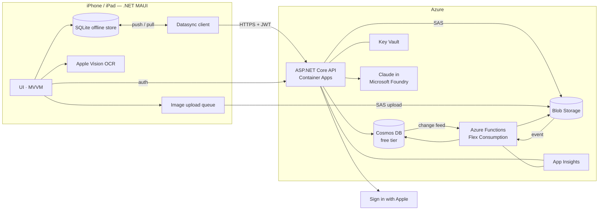

# Dialed — Product & Delivery Plan

| | |
|---|---|
| **Status** | Draft v1 — 2026-11-05 |
| **Owner** | Thomas (@thopdev) |
| **Platforms** | iPhone + iPad (iOS / iPadOS) |
| **Backend** | Azure — ASP.NET Core API + Azure Functions + Cosmos DB |
| **Release target** | Private beta via TestFlight (me + friends), App Store later |

Related: [Architecture](architecture.md) · [Architecture decisions](adr/README.md) · [Backlog (GitHub issues)](https://github.com/thopdev/Dialed/issues) · [Milestones](https://github.com/thopdev/Dialed/milestones)

---

## 1. Vision

**Dialed helps home baristas get every cup dialed in.** Keep track of the beans you buy and who roasted or sold them, what's still in the cupboard, which recipe works for which bean and brewer, and how every brew tasted. Share it all with the people you live with, follow what your friends are brewing, and let AI do the boring parts: photograph a bag to register it, and get concrete suggestions for what to change in your next brew.

## 2. Goals and non-goals

### Goals (MVP = TestFlight beta)
1. Register **beans**, **roasters / sellers** and **bags in inventory** in seconds — manually or by photographing the label.
2. Keep **recipes per brew method** (espresso, pour-over, immersion, cold brew, …), starting from sensible defaults.
3. **Log brews** (dose, yield, grind, time, temperature, taste, rating, photo) and automatically deduct coffee from inventory.
4. **Households**: share beans, inventory, equipment and recipes with the people you live with.
5. **Friends / following**: see what friends brew and copy their recipes or beans.
6. **AI**: label scanning, personalised starting recipes for a new bean, and a dial-in assistant that recommends changes.
7. **Offline-first**: everything in your own household works without a connection and syncs later.
8. Runs on **Azure** at (near) hobby-project cost, fully provisioned from code.

### Non-goals for the MVP
- Public community, public profiles or a public feed (needs moderation) → post-MVP.
- Android or web clients (the architecture should not block them).
- Push notifications, widgets, Apple Watch → post-MVP.
- Monetisation.
- A global, de-duplicated catalog of roasters/beans shared by all users → post-MVP (MVP keeps catalog data per household).

## 3. Users and key scenarios

| Persona | Needs |
|---|---|
| **The home barista** (primary — Thomas) | Detailed tracking, dial-in help, equipment-specific grind settings, statistics later. Uses iPhone at the machine and iPad on the couch. |
| **Household member** | Wants to make a good coffee with the beans that are open *right now* using the recipe that works, and log it with two taps. |
| **Friend** | Follows Thomas, browses his favourite beans and recipes, copies a recipe into their own household. |

Key scenarios (each maps to one or more stories):
1. *New bag arrives* → photograph label → AI fills in roaster, origin, process, roast date, weight → confirm → bag is in inventory.
2. *Morning espresso* → open "Brew" → app suggests the open bag + last good recipe → pull shot with timer → rate it "a bit sour" → assistant suggests "grind 1 step finer" → saved as the next attempt.
3. *Out of signal at a holiday home* → log brews offline → syncs when back online, inventory updated for the whole household.
4. *Friend asks "what's that bean you liked?"* → friend opens your profile → sees shared bean + recipe → copies it to their household.
5. *Running low* → inventory shows bags with < X grams or past their best-before window.

## 4. Scope (MVP)

| Area | Included in MVP |
|---|---|
| **Accounts** | Sign in with Apple; profile (name, avatar, units); sign out; delete account (incl. Apple token revocation); data export (JSON). |
| **Roasters & sellers** | One `Vendor` entity that can be a roaster, a seller, or both: name, country/city, website, notes, logo. |
| **Beans** | Name, roaster, origin (country/region/farm/producer), varieties, process, altitude, roast level & style, decaf, blend components, tasting notes, photos, personal rating & notes. |
| **Inventory** | Bags per bean: seller, price, weight, roast date, purchase/opened/frozen dates, storage, status; remaining grams derived from brews + adjustments; "rest/peak" window based on roast date; low-stock view. |
| **Equipment** | Grinders (with their own setting scale), brewers, espresso machines, kettles, scales, filters, water. |
| **Brew methods & recipes** | System default recipes per method; personal recipes with dose, water/yield, ratio, grind (per grinder), temperature, time, steps (bloom/pours/pre-infusion), filter, notes; recipe versions per bean ("dial-in history"). |
| **Brew log** | Log brew with actual parameters, drink type (espresso, flat white, filter, …), milk, taste feedback (sour↔bitter, weak↔strong, body, sweetness), rating, notes, photo; guided brew timer; history per bean/recipe; inventory deduction. |
| **Photos** | Photos on beans, bags, vendors, brews and profiles; offline capture; thumbnails; EXIF location stripped. |
| **Households** | Personal household on sign-up; create/rename; invite via link/code; roles (owner, member); leave/remove; multiple households with an active one; all coffee data scoped to a household. |
| **Friends** | Follow requests with approval; followers/following lists; per-item visibility (private / household / friends); friend profile with shared beans, recipes and recent brews; copy a recipe or bean to your household; block/remove. |
| **AI** | Label scan (on-device OCR + Claude structured extraction + duplicate matching); starting recipe for a new bean; dial-in assistant after a brew; offline rule-based fallback; per-user quotas. |
| **App experience** | iPhone tab layout, iPad split-view layout, design system, dark mode, Dynamic Type/VoiceOver basics, settings (units, default household, default methods). |
| **Ops** | IaC for all Azure resources, CI/CD, logging/telemetry, crash reporting, budget alerts, TestFlight pipeline. |

### Post-MVP backlog (milestone "Later")
Public community & moderation · push notifications (invites, follow requests, low stock, "bag is at its peak") · statistics & insights · home-screen widgets & Shortcuts · Apple Watch brew timer · barcode scanning · global roaster/bean catalog · import from other coffee apps · Dutch localisation · Android/web client.

## 5. Key decisions

| # | Decision | Status |
|---|---|---|
| [ADR-0001](adr/0001-dotnet-maui-client.md) | .NET MAUI (net10.0-ios) client for iPhone and iPad | Accepted |
| [ADR-0002](adr/0002-backend-hosting.md) | ASP.NET Core API on Azure Container Apps + Azure Functions for background work | Accepted |
| [ADR-0003](adr/0003-cosmos-db.md) | Azure Cosmos DB (NoSQL) on the free tier, shared throughput | Accepted |
| [ADR-0004](adr/0004-offline-first-sync.md) | Offline-first sync with the Datasync Community Toolkit | Accepted — validate in spike |
| [ADR-0005](adr/0005-authentication.md) | Sign in with Apple, API-issued JWT access + refresh tokens | Accepted |
| [ADR-0006](adr/0006-ai.md) | On-device OCR (Apple Vision) + Claude in Microsoft Foundry | Accepted — validate in spike |
| [ADR-0007](adr/0007-infrastructure-as-code.md) | Bicep + Azure Developer CLI, GitHub Actions with OIDC | Accepted |
| [ADR-0008](adr/0008-images.md) | Images in Blob Storage, direct upload with SAS, thumbnails in Functions | Accepted |

## 6. Architecture in one picture

Details: [architecture.md](architecture.md).

## 7. Delivery plan

All of M0–M4 together is the MVP that goes to TestFlight. Milestones are sequential, but stories inside a milestone can run in parallel. No calendar dates yet; add them once the first milestone gives a feel for velocity.

| Milestone | Goal | Exit criteria |
|---|---|---|
| **M0 — Foundations** | A signed-in user on a real iPhone can create one entity offline and see it synced to Cosmos DB in the dev environment. | Repo + CI green · dev environment provisioned from Bicep · Sign in with Apple works end-to-end · Datasync spike done and ADR-0004 confirmed · app shell runs on iPhone and iPad. |
| **M1 — Coffee core** | Thomas can use Dialed daily for his own coffee, offline included. | Vendors, beans, bags, equipment, recipes (incl. defaults) and brew log work offline and sync · inventory deducts from brews · photos upload and show thumbnails. |
| **M2 — Households & friends** | Coffee data is shared within a household and visible to friends. | Invite flow works across two Apple IDs · roles enforced server-side · follow requests + visibility rules enforced · copy recipe/bean from a friend. |
| **M3 — AI** | Label scanning and recipe help are good enough to prefer them over typing. | Label scan ≥ 80% field accuracy on the golden test set · starting recipe + dial-in suggestions in the app · quotas + cost telemetry in place · offline fallback works. |
| **M4 — Beta hardening & TestFlight** | Friends can install and use it without Thomas holding their hand. | Sync conflict tests pass · account deletion + data export · crash reporting + alerts · privacy policy · prod environment · TestFlight build from CI · beta feedback loop. |
| **Later** | Post-MVP backlog. | — |

### Epics

| Epic | Milestone(s) |
|---|---|
| Project setup & CI | M0 |
| Azure infrastructure | M0 (dev), M4 (prod) |
| Authentication & accounts | M0, M4 (deletion/export) |
| Offline-first sync | M0 (spike + skeleton), M4 (hardening) |
| App shell & design system | M0, M1 |
| Roasters & sellers | M1 |
| Beans & inventory | M1 |
| Equipment & brew methods | M1 |
| Recipes | M1 |
| Brew log | M1 |
| Photos & media | M1 |
| Households | M2 |
| Friends & sharing | M2 |
| AI label scanning | M3 |
| AI recipe assistant | M3 |
| Privacy, security & observability | M4 |
| TestFlight beta | M4 |
| Post-MVP backlog | Later |

## 8. Way of working

**GitHub structure**
- **Epics** are parent issues labelled `epic`; **stories** are sub-issues labelled `story` (or `spike` / `chore`).
- Every story has a user story, acceptance criteria as a checklist, technical notes and dependencies.
- **Milestones** = phases above. **Labels**: `area:*` (app, api, functions, infra, sync, auth, ai, data, docs), `size:*` (S ≈ ≤ half a day, M ≈ 1–2 days, L ≈ 3–5 days, XL = split it), `priority:*`.
- Tip: create a GitHub Project board (Board view grouped by Status, a table grouped by Milestone) and add all issues to it. (Projects can't be created from the session that generated this plan.)

**Definition of Ready**: acceptance criteria clear · dependencies done or stubbed · size ≤ L.

**Definition of Done**: acceptance criteria met · unit tests for domain logic and API · works offline where relevant · runs on iPhone *and* iPad layout · telemetry/logging added · docs/ADR updated if a decision changed · merged to `main` via PR with green CI.

**Branching**: trunk-based. Short-lived branches `feat/<issue>-<slug>`, PR into `main`, squash merge, Conventional Commits (`feat:`, `fix:`, `chore:` …) referencing the issue (`Closes #12`).

**Environments**: `dev` (deployed on every merge to `main`) and `prod` (deployed on tag/release, used by TestFlight builds). Local development uses the Cosmos DB emulator and Azurite.

## 9. Cost (TestFlight scale, estimate)

| Item | Expected cost |
|---|---|
| Cosmos DB | Free tier: first 1000 RU/s and 25 GB per account free (one free-tier account per subscription; must be chosen at creation). One shared-throughput database at ≤ 1000 RU/s keeps it free. |
| Container Apps (API) | Consumption plan, scale to zero → expected within the monthly free grant at beta usage. |
| Azure Functions | Flex Consumption → negligible at beta usage. |
| Blob Storage, Key Vault, App Insights | A few euros per month at most. |
| Container registry | Azure Container Registry Basic is a small fixed monthly cost (alternative: GitHub Container Registry). |
| Claude (Foundry) | Pay per token, billed through Azure Marketplace. Capped by per-user daily quotas and an Azure budget alert. Use a small/fast model for extraction and a stronger one for suggestions. |
| Apple Developer Program | Annual fee, required for TestFlight. |
| GitHub Actions | macOS runners (needed for iOS builds) consume private-repo minutes much faster than Linux runners; check your plan's included minutes. |

Put a **budget alert** on the subscription from day one (story in the Azure infrastructure epic).

**Cosmos free tier with two environments:** only one free-tier account is allowed per subscription. Either use one subscription per environment (both free), or keep one subscription and run `dev` and `prod` as two databases inside the single free-tier account (cheapest, but they then share the 1000 RU/s). See open question 3.

## 10. Risks and mitigations

| Risk | Impact | Mitigation |
|---|---|---|
| **iOS builds need a Mac** (Xcode is required to build/sign MAUI iOS apps). | Can't run on device / ship to TestFlight from Windows alone. | Use a Mac (Pair to Mac from Visual Studio) or macOS GitHub Actions runners for builds; see open question 1. |
| **Datasync + Cosmos partitioning** may not fit the household model out of the box. | Rework of sync layer. | Time-boxed spike in M0 before building features; fallback: Datasync with Cosmos via EF Core and `id` partitioning, or a custom repository. |
| **Offline conflicts** in shared households (two people brew from the same bag offline). | Wrong inventory, lost edits. | Inventory is *derived* from append-only brews + adjustments (no shared counter); last-writer-wins only on editable entities; conflict tests in M4. |
| **.NET MAUI on iOS** quality (camera, Vision, layout quirks). | Slower UI work. | Early spike on camera + Vision OCR; keep platform code behind interfaces; use CommunityToolkit.Maui. |
| **AI cost/abuse** | Surprise bill. | Per-user quotas, small model for extraction, budget alerts, token logging. |
| **AI accuracy on labels** (stylised fonts, Dutch/other languages). | Users stop trusting the scan. | Golden test set of real labels, prompt versioning, always a review step, send image when OCR confidence is low. |
| **Data residency** — Claude in Foundry lists Global and US data-zone deployments, no EU zone. | GDPR questions for a public release. | Fine for private beta with informed friends; send no personal data to the model (only label text/images and coffee parameters); revisit before public App Store release. |
| **Scope**: everything is in the MVP. | Beta keeps slipping. | Milestones are usable increments; M1 alone is already useful for Thomas. Cut "Later" aggressively. |

## 11. Open questions

1. **Do you have a Mac** (or are you OK paying for macOS CI minutes / a cloud Mac) for building and signing the iOS app?
2. **Apple Developer Program**: is there already an account (needed for Sign in with Apple, TestFlight and the bundle ID)?
3. **Azure subscription layout**: one subscription with `dev` + `prod`, or separate subscriptions (affects the Cosmos free tier, see §9)?
4. **Region**: West Europe (Amsterdam) for data, and which region for the Foundry/Claude resource?
5. **Time budget**: roughly how many hours per week? Needed to put dates on milestones.
6. **Units & language**: grams and °C only, or also ounces/°F? App UI English only for the beta?
7. **Roaster/bean catalog**: OK that roasters and beans are per household in the MVP (friends copy them), with a global catalog later?

## 12. Assumptions

- "Images" in the brief means photos attached to beans, bags, roasters, brews and profiles (not AI image generation).
- "Links to other people" means households + friends/following (no public community in MVP).
- A user can be in several households; one is "active" in the app. Every user gets a personal household on sign-up.
- Friend content is read **online only** (not synced to the device); your own households' data is fully offline.
- Units: grams, millilitres, °C, seconds; temperatures/ratios stored in SI units and formatted in the app.
