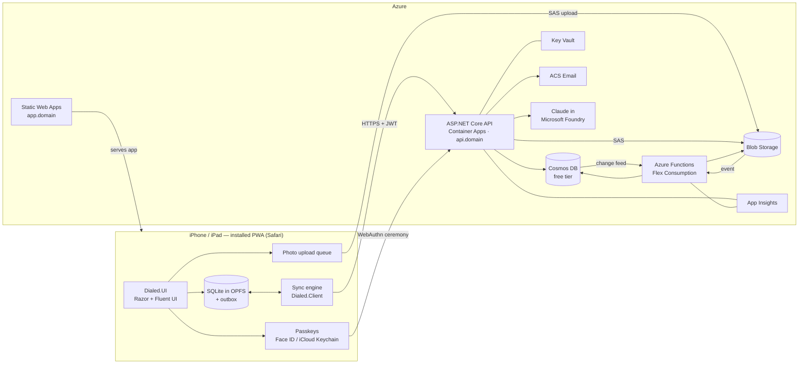

# Dialed — Product & Delivery Plan

| | |
|---|---|
| **Status** | Draft v2 — 2026-11-05 (v1 assumed a native MAUI app; switched to a PWA because there is no Mac) |
| **Owner** | Thomas (@thopdev) |
| **Platforms** | iPhone + iPad as an installable web app (PWA); a native MAUI app stays possible later |
| **Backend** | Azure — ASP.NET Core API + Azure Functions + Cosmos DB, app on Static Web Apps |
| **Release target** | Private beta (me + household + friends), invite-only |

Related: [Architecture](architecture.md) · [Architecture decisions](adr/README.md) · [Backlog (GitHub issues)](https://github.com/thopdev/Dialed/issues) · [Milestones](https://github.com/thopdev/Dialed/milestones)

---

## 1. Vision

**Dialed helps home baristas get every cup dialed in.** Keep track of the beans you buy and who roasted or sold them, what's still in the cupboard, which recipe works for which bean and brewer, and how every brew tasted. Share it all with the people you live with, follow what your friends are brewing, and let AI do the boring parts: photograph a bag to register it, and get concrete suggestions for what to change in your next brew.

## 2. Goals and non-goals

### Goals (MVP = private beta)
1. Register **beans**, **roasters / sellers** and **bags in inventory** in seconds — manually or by photographing the label.
2. Keep **recipes per brew method** (espresso, pour-over, immersion, cold brew, …), starting from sensible defaults.
3. **Log brews** (dose, yield, grind, time, temperature, taste, rating, photo) and automatically deduct coffee from inventory.
4. **Households**: share beans, inventory, equipment and recipes with the people you live with.
5. **Friends / following**: see what friends brew and copy their recipes or beans.
6. **AI**: label scanning, personalised starting recipes for a new bean, and a dial-in assistant that recommends changes.
7. **Offline-first**: everything in your own household works without a connection and syncs later.
8. **Installable on iPhone and iPad** (home screen, full-screen), passwordless sign-in with passkeys (Face ID / Touch ID).
9. **MAUI-ready code**: UI and data/sync logic live in host-independent libraries so a native app can be added later.
10. Runs on **Azure** at (near) hobby-project cost, fully provisioned from code.

### Non-goals for the MVP
- A native App Store app (MAUI) — later; the architecture keeps it possible ([ADR-0009](adr/0009-blazor-pwa-maui-ready.md)).
- Public community, public profiles or a public feed (needs moderation) → post-MVP.
- Push notifications, widgets, Apple Watch → post-MVP.
- Monetisation.
- A global, de-duplicated catalog of roasters/beans shared by all users → post-MVP (MVP keeps catalog data per household).

## 3. Users and key scenarios

| Persona | Needs |
|---|---|
| **The home barista** (primary — Thomas) | Detailed tracking, dial-in help, equipment-specific grind settings, statistics later. Uses iPhone at the machine and iPad on the couch. |
| **Household member** | Wants to make a good coffee with the beans that are open *right now* using the recipe that works, and log it with a few taps. |
| **Friend** | Follows Thomas, browses his favourite beans and recipes, copies a recipe into their own household. |

Key scenarios (each maps to one or more stories):
1. *New bag arrives* → photograph label → AI fills in roaster, origin, process, roast date, weight → confirm → bag is in inventory.
2. *Morning espresso* → open "Brew" → app suggests the open bag + last good recipe → pull shot with timer → rate it "a bit sour" → assistant suggests "grind 1 step finer" → saved as the next attempt.
3. *Out of signal at a holiday home* → log brews offline → syncs when back online, inventory updated for the whole household.
4. *Friend asks "what's that bean you liked?"* → friend opens your profile → sees shared bean + recipe → copies it to their household.
5. *Running low* → inventory shows bags with < X grams or past their best-before window.

## 4. Scope (MVP)

| Area | Included in MVP |
|---|---|
| **Accounts** | Passkey sign-up/sign-in (Face ID / Touch ID); email confirmation; recovery codes + email recovery; multiple passkeys; invite-only sign-up during beta; profile (name, avatar, units); sign out; delete account; data export (JSON). |
| **App** | Installable PWA (manifest, icons, service worker, update prompt), "Add to Home Screen" guide for iOS, iPhone bottom navigation, iPad sidebar + list/detail, Fluent UI Blazor design system with coffee theme, dark mode, accessibility basics. |
| **Roasters & sellers** | One `Vendor` entity that can be a roaster, a seller, or both: name, country/city, website, notes, logo. |
| **Beans** | Name, roaster, origin (country/region/farm/producer), varieties, process, altitude, roast level & style, decaf, blend components, tasting notes, photos, personal rating & notes. |
| **Inventory** | Bags per bean: seller, price, weight, roast date, purchase/opened/frozen dates, storage, status; remaining grams derived from brews + adjustments; "rest/peak" window based on roast date; low-stock view. |
| **Equipment** | Grinders (with their own setting scale), brewers, espresso machines, kettles, scales, filters, water. |
| **Brew methods & recipes** | System default recipes per method; personal recipes with dose, water/yield, ratio, grind (per grinder), temperature, time, steps (bloom/pours/pre-infusion), filter, notes; recipe versions per bean ("dial-in history"). |
| **Brew log** | Log brew with actual parameters, drink type (espresso, flat white, filter, …), milk, taste feedback (sour↔bitter, weak↔strong, body, sweetness), rating, notes, photo; guided brew timer with sound cues; history per bean/recipe; inventory deduction. |
| **Photos** | Photos on beans, bags, vendors, brews and profiles; offline capture; resized in the browser; thumbnails; EXIF location stripped. |
| **Households** | Personal household on sign-up; create/rename; invite via code (+ link); roles (owner, member); leave/remove; multiple households with an active one; all coffee data scoped to a household. |
| **Friends** | Follow requests with approval; followers/following lists; per-item visibility (private / household / friends); friend profile with shared beans, recipes and recent brews; copy a recipe or bean to your household; block/remove. |
| **AI** | Label scan (photo → Claude structured extraction + duplicate matching); starting recipe for a new bean; dial-in assistant after a brew; offline rule-based fallback; per-user quotas. |
| **Ops** | IaC for all Azure resources, CI/CD with PR preview environments, custom domain, telemetry, error reporting, budget alerts. |

### Post-MVP backlog (milestone "Later")
Native iOS app with MAUI Blazor Hybrid (App Store) · widgets, Shortcuts & Apple Watch (need the native app) · web push notifications (invites, follow requests, low stock, "bag is at its peak") · statistics & insights · barcode scanning · global roaster/bean catalog · public community & moderation · import from other coffee apps · Dutch localisation.

## 5. Key decisions

| # | Decision | Status |
|---|---|---|
| [ADR-0009](adr/0009-blazor-pwa-maui-ready.md) | Blazor WebAssembly PWA (Fluent UI Blazor, Static Web Apps), structured for a MAUI app later | Accepted |
| [ADR-0002](adr/0002-backend-hosting.md) | ASP.NET Core API on Azure Container Apps + Azure Functions for background work | Accepted |
| [ADR-0003](adr/0003-cosmos-db.md) | Azure Cosmos DB (NoSQL) on the free tier, shared throughput | Accepted |
| [ADR-0011](adr/0011-browser-offline-storage-and-sync.md) | SQLite in the browser + own sync engine on the Datasync server protocol | Accepted — validate in spike |
| [ADR-0010](adr/0010-passkeys.md) | Passkeys with ASP.NET Core Identity, API-issued JWT; custom domain | Accepted — validate in spike |
| [ADR-0006](adr/0006-ai.md) | Claude in Microsoft Foundry: label photos → structured data, recipe help | Accepted — validate in spike |
| [ADR-0007](adr/0007-infrastructure-as-code.md) | Bicep + Azure Developer CLI, GitHub Actions with OIDC | Accepted |
| [ADR-0008](adr/0008-images.md) | Images resized in the browser, Blob Storage with SAS upload, thumbnails in Functions | Accepted |
| [ADR-0001](adr/0001-dotnet-maui-client.md), [0004](adr/0004-offline-first-sync.md), [0005](adr/0005-authentication.md) | MAUI client, Datasync offline client, Sign in with Apple | Superseded |

## 6. Architecture in one picture

Details: [architecture.md](architecture.md).

## 7. Delivery plan

All of M0–M4 together is the MVP that goes to the private beta. Milestones are sequential, but stories inside a milestone can run in parallel. No calendar dates yet; add them once the first milestone gives a feel for velocity.

| Milestone | Goal | Exit criteria |
|---|---|---|
| **M0 — Foundations** | On a real iPhone, the installed PWA lets you sign up with a passkey, create an entity offline and see it synced to Cosmos DB in dev. | Repo + CI green · dev environment provisioned from Bicep · passkey sign-up/sign-in end-to-end on localhost, on the iPhone via a dev tunnel and in Azure dev · both spikes done (ADR-0010 and ADR-0011 confirmed) · app shell + PWA install on iPhone and iPad. |
| **M1 — Coffee core** | Thomas uses Dialed daily for his own coffee, offline included. | Vendors, beans, bags, equipment, recipes (incl. defaults) and brew log work offline and sync · inventory deducts from brews · photos upload and show thumbnails · account recovery works. |
| **M2 — Households & friends** | Coffee data is shared within a household and visible to friends. | Invite flow works across two accounts on two devices · roles enforced server-side · follow requests + visibility rules enforced · copy recipe/bean from a friend. |
| **M3 — AI** | Label scanning and recipe help are good enough to prefer them over typing. | Label scan ≥ 80% field accuracy on the golden test set · starting recipe + dial-in suggestions in the app · quotas + cost telemetry in place · offline fallback works. |
| **M4 — Beta hardening & private beta** | Friends can install and use it without Thomas holding their hand. | Sync conflict tests pass · storage-loss recovery tested on iOS · account deletion + data export · error reporting + alerts · privacy policy · custom domain + prod environment · invite-only sign-up · feedback loop. |
| **Later** | Post-MVP backlog. | — |

### Epics

| Epic | Milestone(s) |
|---|---|
| [#1 Project setup & CI](https://github.com/thopdev/Dialed/issues/1) | M0 |
| [#2 Azure infrastructure](https://github.com/thopdev/Dialed/issues/2) | M0 (dev), M3 (Foundry), M4 (domain + prod) |
| [#3 Authentication & accounts](https://github.com/thopdev/Dialed/issues/3) | M0 (passkeys), M1 (profile, recovery, beta gate), M4 (deletion/export) |
| [#4 Offline-first sync](https://github.com/thopdev/Dialed/issues/4) | M0 (spike + engine), M1 (storage loss), M2 (household scoping), M4 (hardening) |
| [#5 App shell, PWA & design system](https://github.com/thopdev/Dialed/issues/5) | M0, M1, M4 (accessibility) |
| [#6 Roasters & sellers](https://github.com/thopdev/Dialed/issues/6) | M1 |
| [#7 Beans & inventory](https://github.com/thopdev/Dialed/issues/7) | M1 |
| [#8 Equipment & brew methods](https://github.com/thopdev/Dialed/issues/8) | M1 |
| [#9 Recipes](https://github.com/thopdev/Dialed/issues/9) | M1 |
| [#10 Brew log](https://github.com/thopdev/Dialed/issues/10) | M1 |
| [#11 Photos & media](https://github.com/thopdev/Dialed/issues/11) | M1 |
| [#12 Households](https://github.com/thopdev/Dialed/issues/12) | M2 |
| [#13 Friends & sharing](https://github.com/thopdev/Dialed/issues/13) | M2 |
| [#14 AI label scanning](https://github.com/thopdev/Dialed/issues/14) | M3 |
| [#15 AI recipe assistant](https://github.com/thopdev/Dialed/issues/15) | M3 |
| [#16 Privacy, security & observability](https://github.com/thopdev/Dialed/issues/16) | M1 (telemetry), M4 |
| [#17 Private beta](https://github.com/thopdev/Dialed/issues/17) | M4 |
| [#18 Post-MVP backlog](https://github.com/thopdev/Dialed/issues/18) | Later |

**Where to start (M0 critical path):**
1. #19 solution structure → #20 local dev (passkeys on localhost; iPhone via a dev tunnel) → #21 CI.
2. The two spikes, before any feature work: #37 SQLite in the browser + sync protocol, and #29 cookie-less passkeys with Identity + Cosmos DB.
3. Infra: #24 Bicep for dev → #22 PWA deploys with PR previews. (The custom domain, #111, waits until M4.)
4. App: #44 shell → #115 PWA install/offline → #116 platform abstractions.
5. Then #30 passkey API → #32 sign-in screens, and #38 sync server → #39 sync engine.

## 8. Way of working

**GitHub structure**
- **Epics** are parent issues labelled `epic`; **stories** are sub-issues labelled `story` (or `spike` / `chore`).
- Every story has a user story, acceptance criteria as a checklist, technical notes and dependencies.
- **Milestones** = phases above. **Labels**: `area:*` (app, api, functions, infra, sync, auth, ai, data, ci, docs), `size:*` (S ≈ ≤ half a day, M ≈ 1–2 days, L ≈ 3–5 days, XL = split it), `priority:*`.
- Tip: create a GitHub Project board (Board view grouped by Status, a table grouped by Milestone) and add all issues to it.

**Definition of Ready**: acceptance criteria clear · dependencies done or stubbed · size ≤ L.

**Definition of Done**: acceptance criteria met · unit tests for domain logic, sync and API · works offline where relevant · checked in Safari on iPhone *and* iPad (installed PWA) · no browser APIs in `Dialed.UI`/`Dialed.Client` · telemetry/logging added · docs/ADR updated if a decision changed · merged to `main` via PR with green CI.

**Branching**: trunk-based. One short-lived branch and PR per story (`feat/<issue>-<slug>`), `Closes #N` in the PR, Thomas reviews and merges (squash), Conventional Commits (`feat:`, `fix:`, `chore:` …).

**Tooling**: VS Code + C# Dev Kit (recommended extensions and launch configs in `.vscode/`) · tests with xUnit v3 + Shouldly · Playwright (WebKit) for end-to-end.

**Environments**: local (passkeys on `localhost` in the PC browser; on the iPhone via a persistent Microsoft dev tunnel) · PR preview environments (Static Web Apps) against the `dev` API · `dev` (deployed on every merge to `main`, Azure default hostnames) · `prod` (custom domain, deployed on release tag). Local stack: `dotnet watch` + Cosmos DB emulator + Azurite.

## 9. Cost (private beta, estimate)

| Item | Expected cost |
|---|---|
| Cosmos DB | Free tier: first 1000 RU/s and 25 GB per account free (one free-tier account per subscription; must be chosen at creation). Default: one subscription, `dev` and `prod` as two databases sharing the free 1000 RU/s. |
| Static Web Apps | Free plan (2 custom domains, 3 preview environments, 100 GB bandwidth/month). |
| Container Apps (API) | Consumption plan, scale to zero → expected within the monthly free grant at beta usage. |
| Azure Functions | Flex Consumption → negligible at beta usage. |
| Blob Storage, Key Vault, App Insights, ACS Email | A few euros per month at most. |
| Container registry | Azure Container Registry Basic is a small fixed monthly cost (alternative: GitHub Container Registry). |
| Claude (Foundry) | Pay per token, billed through Azure Marketplace. Capped by per-user daily quotas and an Azure budget alert. |
| Domain name | Yearly registration fee at a registrar. |
| Apple Developer Program | **Not needed** for the PWA beta (only for a later native app). |

Put a **budget alert** on the subscription from day one (story in the Azure infrastructure epic).

## 10. Risks and mitigations

| Risk | Impact | Mitigation |
|---|---|---|
| **iOS clears website storage** (local DB, pending photos). | Unsynced brews/photos lost; slow re-download. | Install to home screen, request persistent storage on each launch, push eagerly, full re-sync when the DB is missing, warn on old unsynced changes; test > 7 days unused on a real device (M0 spike). |
| **SQLite-in-the-browser libraries are young** (Bit.Bsqlite, SqliteWasmBlazor). | Bugs or abandonment. | Spike in M0; keep them behind EF Core so they can be swapped; IndexedDB (Dexie) as last-resort fallback. |
| **Passkey ceremony across app/API origins** (Identity's default keeps state in a cookie; Safari blocks cross-site cookies). | Sign-in doesn't work in Safari. | Cookie-less ceremony with a protected, single-use state token (ADR-0010); validated in the M0 spike on localhost, a dev tunnel and Azure dev. |
| **Passkeys are bound to their RP ID (domain)**. | Changing the prod domain later invalidates all accounts. | Choose the domain before the first beta tester signs up (M4, open question 1); dev/test passkeys are throwaway. |
| **Identity on Cosmos DB** has no official EF store. | Extra work. | Custom stores (small surface) or EF Core Cosmos provider; spike. |
| **PWA limitations on iOS** (no haptics, manual install, links open in Safari). | Feels less native. | Install guide, sound/visual cues, codes instead of links where needed; native MAUI host later (ADR-0009). |
| **Datasync server + Cosmos partitioning** may not fit the household model out of the box. | Rework of sync layer. | M0 spike; fallback: `/id` partitioning with cross-partition queries at beta scale. |
| **Offline conflicts** in shared households. | Wrong inventory, lost edits. | Inventory derived from append-only brews + adjustments; last-writer-wins only on editable entities; conflict tests in M4. |
| **AI cost/abuse** | Surprise bill. | Per-user quotas, resized images, small model for extraction, budget alerts, token logging. |
| **AI accuracy on labels** (stylised fonts, other languages). | Users stop trusting the scan. | Golden test set, prompt versioning, always a review step. |
| **Data residency** — Claude in Foundry lists Global and US data-zone deployments, no EU zone. | GDPR questions for a public release. | Fine for a private beta with informed friends; no personal data in prompts; revisit before a public release. |
| **Scope**: everything is in the MVP. | Beta keeps slipping. | Milestones are usable increments; M1 alone is already useful for Thomas. Cut "Later" aggressively. |

## 11. Open questions

1. **Domain name**: which domain should Dialed use for prod (`app.<domain>` + `api.<domain>`)? Needed before the first beta tester (M4, #111). Development runs on localhost, a dev tunnel and Azure default hostnames.

Resolved:
- No Mac → PWA instead of MAUI (ADR-0009); no Apple Developer Program needed for the beta.
- Passkeys: cookie-less ceremony, `localhost` locally, dev tunnel on the iPhone (ADR-0010).
- Azure: one subscription for now, region West Europe; Claude resource in the nearest region that offers it.
- Units: grams/°C by default, ounces/°F switchable per user.
- Language: English UI for the beta, all text in resource files (Dutch later).
- Roasters and beans are per household in the MVP; global catalog later.
- Tests: xUnit v3 + Shouldly. IDE: VS Code + C# Dev Kit. Workflow: one PR per story, Thomas merges.
- No fixed weekly hours → no milestone dates yet.

## 12. Assumptions

- Testers use iOS/iPadOS 17 or later and install the PWA to the home screen.
- "Images" in the brief means photos attached to beans, bags, roasters, brews and profiles (not AI image generation).
- "Links to other people" means households + friends/following (no public community in MVP).
- A user can be in several households; one is "active" in the app. Every user gets a personal household on sign-up.
- Friend content is read **online only** (not synced to the device); your own households' data is fully offline.
- Units: stored in SI (grams, millilitres, °C, seconds); shown in grams/°C or ounces/°F per user preference.
