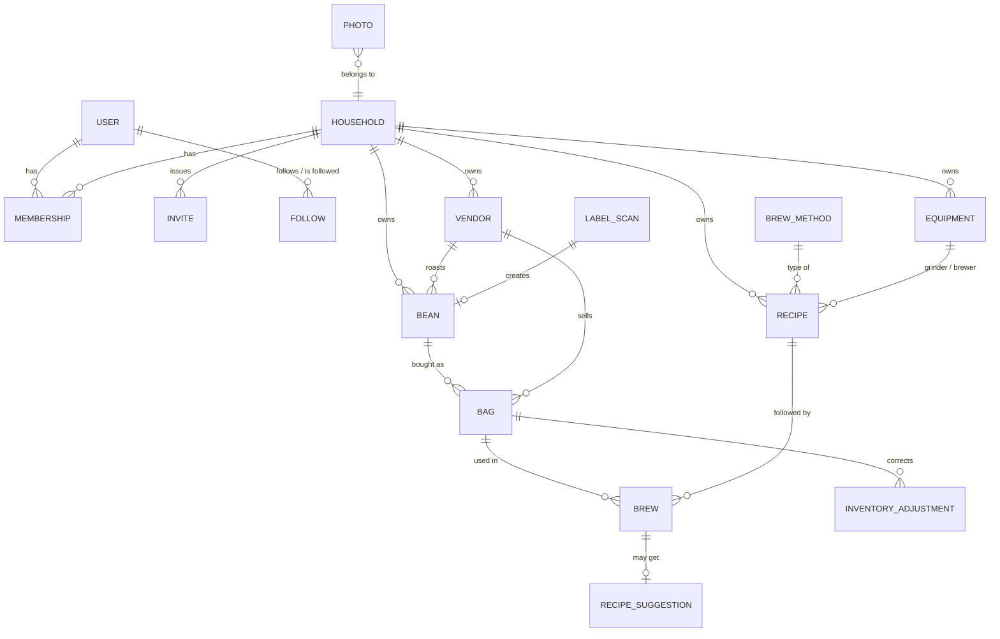
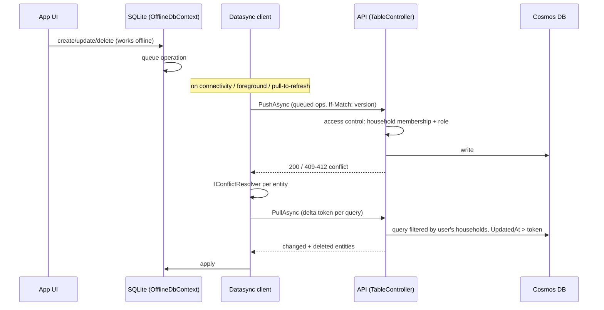
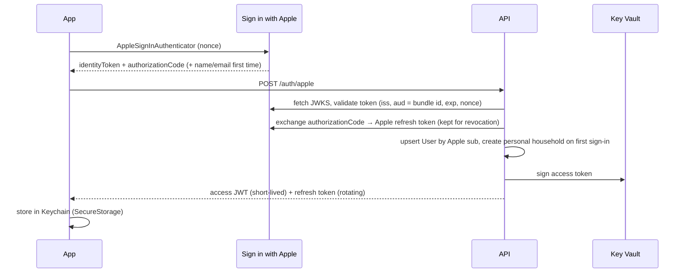
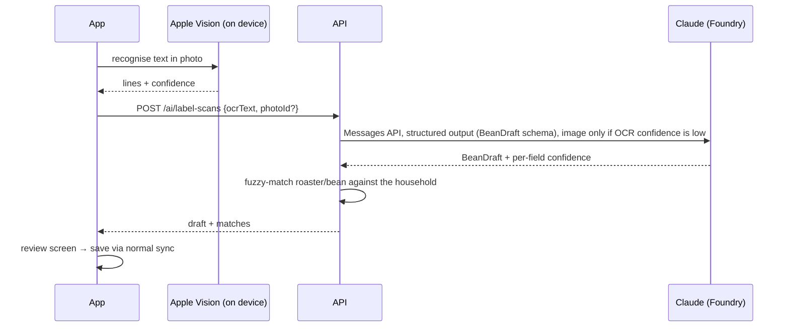

# Dialed — Architecture

Companion to [PLAN.md](PLAN.md). Decisions and their alternatives are in [adr/](adr/README.md).

## 1. Components

| Component | Tech | Responsibility |
|---|---|---|
| **Dialed.App** | .NET MAUI (`net10.0-ios`), MVVM (CommunityToolkit.Mvvm), CommunityToolkit.Maui | iPhone + iPad UI, offline store (SQLite via Datasync `OfflineDbContext`), camera + on-device OCR, image upload queue, brew timer, rule-based dial-in fallback. |
| **Dialed.Api** | ASP.NET Core 10 on Azure Container Apps | Auth (Sign in with Apple → JWT), Datasync table controllers, households, friends, AI endpoints, SAS issuing, account deletion/export. |
| **Dialed.Functions** | Azure Functions, .NET 10 isolated worker, Flex Consumption | Thumbnail generation + EXIF stripping (blob events), change-feed jobs (denormalised friend views, cleanup of deleted data), scheduled jobs (invite expiry, soft-delete purge). |
| **Dialed.Domain** | .NET class library | Entities, value objects, validation, inventory calculation, dial-in rules — shared by App, Api and Functions. |
| **Dialed.AI** | .NET class library | Claude client (Anthropic C# SDK with Foundry support, or plain `HttpClient`), prompt templates, JSON schemas, prompt versioning. |
| **infra/** | Bicep + `azure.yaml` (Azure Developer CLI) | All Azure resources for `dev` and `prod`. |

### Proposed repository layout

```
/src
  Dialed.App/            .NET MAUI app (iOS/iPadOS)
  Dialed.Api/            ASP.NET Core API + Datasync server
  Dialed.Functions/      Azure Functions (isolated worker)
  Dialed.Domain/         Shared domain model + logic
  Dialed.AI/             Claude integration, prompts, schemas
/tests
  Dialed.Domain.Tests/
  Dialed.Api.Tests/      incl. integration tests against the Cosmos DB emulator
  Dialed.AI.Tests/       golden-set evaluation for label extraction
/infra                   Bicep modules + main.bicep + azure.yaml
/docs                    Plan, architecture, ADRs
/.github/workflows       CI, deploy, iOS build
Dialed.sln
Directory.Build.props / Directory.Packages.props (central package management)
```

## 2. Domain model

All coffee data belongs to exactly one **household**. Every synced entity has the Datasync metadata fields `Id` (client-generated GUID string), `UpdatedAt`, `Version` and `Deleted` (soft delete), plus `HouseholdId`, `CreatedBy`, `UpdatedBy` and `Visibility` where relevant.



| Entity | Key fields | Synced offline? |
|---|---|---|
| `User` | AppleSub, DisplayName, AvatarPhotoId, Units, ActiveHouseholdId, IsPrivate | Own profile only |
| `Household` | Name, OwnerId | Yes (households you're in) |
| `Membership` | HouseholdId, UserId, Role (Owner/Member), JoinedAt | Yes (read-only on device) |
| `Invite` | HouseholdId, Code, ExpiresAt, MaxUses, CreatedBy | No (online) |
| `Follow` | FollowerId, FolloweeId, Status (Requested/Accepted), CreatedAt | No (online) |
| `Vendor` | Name, Kinds [Roaster, Seller], Country, City, Website, Notes, LogoPhotoId | Yes |
| `Bean` | Name, RoasterId, Origin {Country, Region, Farm, Producer}, Varieties[], Process, AltitudeM, RoastLevel, RoastStyle (Espresso/Filter/Omni), IsDecaf, Components[] (blends), TastingNotes[], PhotoIds[], Rating, Notes, Visibility, SourceScanId | Yes |
| `Bag` | BeanId, SellerId, PriceCents, Currency, WeightG, RoastDate, PurchasedOn, OpenedOn, FrozenOn, Storage, Status (Sealed/Open/Frozen/Finished), RestDays (override) | Yes |
| `InventoryAdjustment` | BagId, DeltaG, Reason (Spilled/Gifted/Correction/Other) | Yes (append-only) |
| `Equipment` | Kind (Grinder/Brewer/EspressoMachine/Kettle/Scale/Filter/Water), Brand, Model, GrindScale {Min, Max, Step, Unit}, Notes | Yes |
| `BrewMethod` | Code (espresso, v60, aeropress, …), Category (Espresso/PourOver/Immersion/ColdBrew/Other), ParameterSet | Seeded, read-only |
| `Recipe` | MethodCode, Name, BeanId?, GrinderId?, BrewerId?, DoseG, WaterG / YieldG, Ratio, GrindSetting, TempC, TimeS, PreinfusionS, Steps[] {Kind, AtS, WaterG, Note}, Filter, Notes, ParentRecipeId (versioning), IsDefaultTemplate, Visibility | Yes |
| `Brew` | BagId, RecipeId, BrewedAt, BrewedBy, DrinkType, MilkMl, MilkType, actual DoseG/YieldG/WaterG/GrindSetting/TempC/TimeS, Taste {Acidity −2..+2 (sour↔bitter), Strength −2..+2, Body, Sweetness}, Rating 1–5, Notes, PhotoIds[] | Yes (append-mostly) |
| `RecipeSuggestion` | BrewId/BeanId, Kind (StartingRecipe/DialIn), Changes[] {Parameter, From, To, Reason}, Source (AI/Rules), PromptVersion, Accepted | Yes |
| `LabelScan` | PhotoId, OcrText, ExtractedJson, FieldConfidence, Status, PromptVersion, ModelId | Yes |
| `Photo` | BlobPath, ThumbPath, Width, Height, OwnerEntity {Type, Id}, UploadState | Yes (metadata) |

**Remaining coffee in a bag** is never stored as a mutable counter: `remaining = WeightG − Σ brew.DoseG − Σ adjustment.DeltaG`. Because brews and adjustments are append-only, two people brewing from the same bag offline can never overwrite each other.

**Visibility** (`Private`, `Household`, `Friends`) applies to beans, recipes and brews. Default: `Household`. `Friends` makes the item readable by accepted followers of the creator.

### Cosmos DB layout
- One database with **shared throughput** (≤ 1000 RU/s → free tier), one container per synced entity type (≤ 25 containers on the free shared database).
- Partition key: `/householdId` for household data, `/id` for users, `/followerId` for follows. To be confirmed by the Datasync spike (see ADR-0004).
- Change feed → Functions for derived data (e.g. a `FriendFeed` container per follower, cleanup when a household is deleted).

## 3. Offline-first sync



Rules:
- **Client-generated IDs** (GUID strings) so anything can be created offline.
- **Server-side access control** (`IAccessControlProvider<T>`): `GetDataView()` limits to the caller's households; `IsAuthorizedAsync()` checks role; `PreCommitHookAsync()` stamps `HouseholdId`, `CreatedBy`, `UpdatedBy` and rejects household changes the caller isn't allowed to make.
- **Conflicts**: brews, adjustments and label scans are append-only (practically conflict-free). Editable entities (bean, bag, vendor, recipe, equipment) use last-writer-wins via `ClientWinsConflictResolver`, and the overwritten server version is logged so it can be surfaced later.
- **Soft delete** everywhere so deletions sync; Functions purge soft-deleted items after 30 days.
- **Leaving a household** purges its data from the device and resets its delta tokens.
- **Friend content** is fetched online-only through regular endpoints and cached in memory/disk; it is never part of the offline store.
- **Photos** are not part of Datasync: the binary goes through the image upload queue (§6), only metadata syncs.

## 4. Authentication



- Access token ≈ 30 min, refresh token ≈ 60 days, rotated on use, stored hashed server-side, revocable.
- Claims: `sub` (user id), `households` is **not** put in the token (membership changes must apply immediately); the API looks it up with a short cache.
- Account deletion: delete/anonymise user data, revoke API refresh tokens and revoke the Apple token through Apple's REST API.
- Development: a dev-only test login (disabled outside `Development`) for integration tests and the simulator.

## 5. AI

### Label scan

- Offline: the scan (photo + OCR text) is stored as a `LabelScan` with status `Pending` and processed when back online.
- Golden test set: ~30 real labels with expected JSON, run in CI on prompt changes (not on every commit, it costs tokens).

### Recipe assistant
- **Starting recipe**: input = bean (roast level, process, origin, days since roast), method template, user's equipment (grinder scale) → output = recipe with per-parameter reasoning.
- **Dial-in**: input = recipe, last N brews of this bag with taste feedback → output = 1–2 concrete changes (e.g. "grind 2 steps finer", "yield 36 → 40 g") + why.
- **Offline / fallback**: deterministic rules in `Dialed.Domain` (e.g. sour + fast → finer; bitter + slow → coarser) give a suggestion immediately; AI refines when online.
- Prompts are versioned (`PromptVersion` stored on every result); model IDs are configuration (small/fast model for extraction, stronger model for suggestions).
- No personal data in prompts: only coffee data.
- Quotas: e.g. 20 scans + 50 suggestions per user per day (configurable), enforced in the API.

## 6. Images

1. App saves photo locally (resized to max 2048 px, JPEG/HEIC → JPEG) and creates `Photo` metadata (syncs).
2. Upload queue asks the API for a short-lived **user-delegation SAS** for `photos/{householdId}/{photoId}.jpg` and uploads directly to Blob Storage.
3. Blob event → Function strips EXIF (incl. GPS) and creates thumbnails (e.g. 256 px, 768 px), updates `Photo.ThumbPath`.
4. Reads use short-lived read SAS URLs from the API; the app caches images on disk.

## 7. Azure resources (per environment)

| Resource | SKU / notes |
|---|---|
| Resource group | `rg-dialed-{env}` |
| Container Apps environment + app `ca-dialed-api` | Consumption, min replicas 0 (dev) / 0–1 (prod) |
| Container registry | ACR Basic (shared) or GHCR |
| Function app `func-dialed-{env}` | Flex Consumption, .NET 10 isolated |
| Cosmos DB account | NoSQL API, free tier (one per subscription), shared throughput DB |
| Storage account | Blob (photos), + Functions deployment storage |
| Key Vault | JWT signing key, Apple Sign-in key (.p8), secrets |
| Microsoft Foundry resource | Claude deployments (Global Standard) |
| Log Analytics + Application Insights | API, Functions, availability test |
| Managed identities + RBAC | API/Functions → Cosmos (data plane RBAC), Storage, Key Vault, Foundry — no connection-string secrets |
| Budget + alerts | Subscription budget with email alert |

CI/CD: GitHub Actions with **OIDC federated credentials** to Azure (no stored Azure secrets). `azd provision` / `azd deploy` for infra + API + Functions; a macOS job builds and signs the iOS app and uploads it to TestFlight.

## 8. Security and privacy basics
- HTTPS only, JWT auth on every endpoint except `/auth/*` and health.
- Authorization always server-side (household role, visibility, follow status); never trust IDs from the client.
- Rate limiting per user (ASP.NET Core rate limiter), stricter on AI and auth endpoints.
- Input validation in `Dialed.Domain` shared by app and API.
- EXIF/GPS stripped from photos; photos stored per household path; SAS tokens short-lived and scoped to one blob.
- Secrets only in Key Vault; managed identities everywhere; Dependabot for dependencies.
- Account deletion + JSON export; privacy policy before external TestFlight testers.

## 9. Observability
- API + Functions: OpenTelemetry → Application Insights (requests, dependencies, custom metrics: sync push/pull counts, conflict count, AI tokens per call, AI latency).
- App: crash + error reporting (Sentry for .NET MAUI, or App Insights via OpenTelemetry — decide in the story), sync diagnostics screen in settings.
- Alerts: API 5xx rate, Function failures, AI daily token spend, budget.
