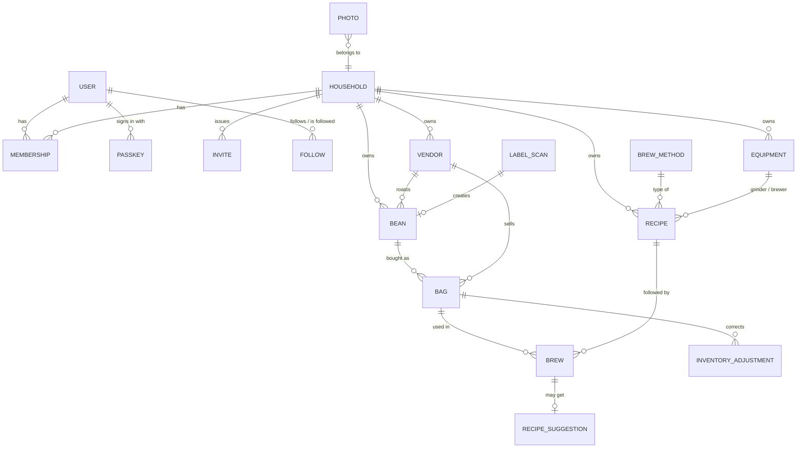
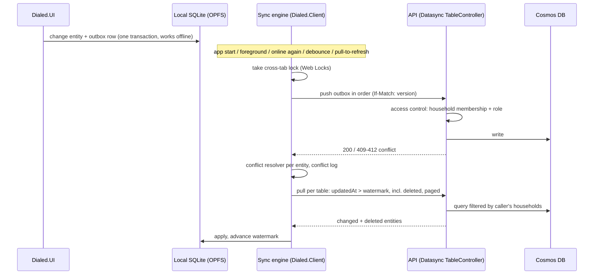
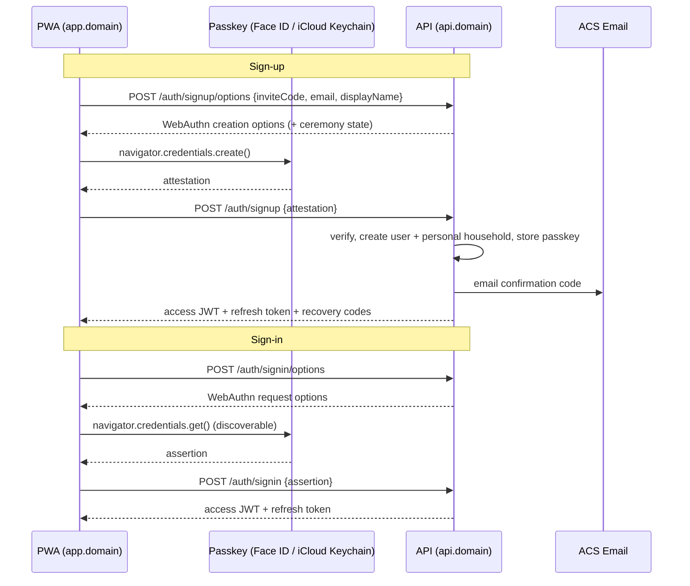
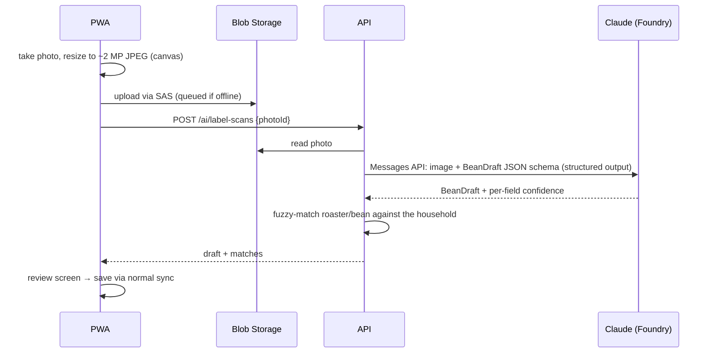

# Dialed — Architecture

Companion to [PLAN.md](PLAN.md). Decisions and their alternatives are in [adr/](adr/README.md).

## 1. Components

| Component | Tech | Responsibility |
|---|---|---|
| **Dialed.Web** | Blazor WebAssembly (.NET 10) PWA on Azure Static Web Apps | Host for the app: service worker, web manifest, JS interop implementations of platform services (camera, local files, WebAuthn, wake lock, share), SQLite-WASM provider. |
| **Dialed.UI** | Razor Class Library, Fluent UI Blazor | All pages, components and layouts (iPhone + iPad), UI state. Host-independent. |
| **Dialed.Client** | .NET class library | Local EF Core `DbContext`, sync engine (outbox, push/pull, conflicts), photo upload queue, typed API clients, platform-service interfaces. Host-independent. |
| **Dialed.Api** | ASP.NET Core 10 on Azure Container Apps (`api.<domain>`) | Identity + passkeys → JWT, Datasync table controllers, households, friends, AI endpoints, SAS issuing, account deletion/export. |
| **Dialed.Functions** | Azure Functions, .NET 10 isolated worker, Flex Consumption | Thumbnails (blob events), change-feed jobs (friend feed, cleanup), scheduled jobs (invite expiry, soft-delete purge). |
| **Dialed.Domain** | .NET class library | Entities, value objects, validation, inventory calculation, dial-in rules — shared by client, API and Functions. |
| **Dialed.AI** | .NET class library | Claude client (Anthropic C# SDK with Foundry support, or `HttpClient`), prompt templates, JSON schemas, prompt versioning. |
| *Later:* **Dialed.App** | .NET MAUI Blazor Hybrid | Native host reusing `Dialed.UI` + `Dialed.Client` (see §10). |
| **infra/** | Bicep + `azure.yaml` (Azure Developer CLI) | All Azure resources for `dev` and `prod`. |

### Proposed repository layout

```
/src
  Dialed.Web/            Blazor WebAssembly PWA host
  Dialed.UI/             Razor Class Library: pages + components (Fluent UI Blazor)
  Dialed.Client/         Local DB, sync engine, API clients, platform interfaces
  Dialed.Api/            ASP.NET Core API: Identity/passkeys, Datasync server, endpoints
  Dialed.Functions/      Azure Functions (isolated worker)
  Dialed.Domain/         Shared domain model + logic
  Dialed.AI/             Claude integration, prompts, schemas
  Dialed.AppHost/        Aspire AppHost: local orchestration (Cosmos DB emulator, Azurite, apps, dev tunnel)
  Dialed.ServiceDefaults/  OpenTelemetry, health checks, service discovery, resilience
/tests
  Dialed.AppHost.Tests/  resource model of the local stack
  Dialed.Domain.Tests/
  Dialed.Client.Tests/   sync engine against an in-memory/real API
  Dialed.Api.Tests/      incl. integration tests against the Cosmos DB emulator
  Dialed.AI.Tests/       golden-set evaluation for label extraction
  Dialed.ArchitectureTests/  UI/Client must not depend on browser-only APIs
  Dialed.E2E/            Playwright tests (WebKit = Safari engine, iPhone/iPad viewports)
/infra                   Bicep modules + main.bicep + azure.yaml
/docs                    Plan, architecture, ADRs
/.github/workflows       CI, deploy
Dialed.slnx
Directory.Build.props / Directory.Packages.props (central package management)
```

## 2. Domain model

All coffee data belongs to exactly one **household**. Every synced entity has the sync metadata fields `Id` (client-generated GUID string), `UpdatedAt`, `Version` and `Deleted` (soft delete), plus `HouseholdId`, `CreatedBy`, `UpdatedBy` and `Visibility` where relevant.



| Entity | Key fields | Synced offline? |
|---|---|---|
| `User` (Identity) | Email, EmailConfirmed, DisplayName, AvatarPhotoId, Units, ActiveHouseholdId, FriendCode | Own profile only |
| `Passkey` (Identity) | CredentialId, PublicKey, SignCount, IsBackedUp, Name, CreatedAt | No (server only) |
| `Household` | Name, OwnerId | Yes (households you're in) |
| `Membership` | HouseholdId, UserId, Role (Owner/Member), JoinedAt | Yes (read-only on device) |
| `Invite` | HouseholdId, Code, ExpiresAt, MaxUses, CreatedBy | No (online) |
| `Follow` | FollowerId, FolloweeId, Status (Requested/Accepted/Blocked), CreatedAt | No (online) |
| `Vendor` | Name, Kinds [Roaster, Seller], Country, City, Website, Notes, LogoPhotoId | Yes |
| `Bean` | Name, RoasterId, Origin {Country, Region, Farm, Producer}, Varieties[], Process, AltitudeM, RoastLevel, RoastStyle (Espresso/Filter/Omni), IsDecaf, Components[] (blends), TastingNotes[], PhotoIds[], Rating, Notes, Visibility, SourceScanId | Yes |
| `Bag` | BeanId, SellerId, PriceCents, Currency, WeightG, RoastDate, PurchasedOn, OpenedOn, FrozenOn, Storage, Status (Sealed/Open/Frozen/Finished), RestDays (override) | Yes |
| `InventoryAdjustment` | BagId, DeltaG, Reason (Spilled/Gifted/Correction/Other) | Yes (append-only) |
| `Equipment` | Kind (Grinder/Brewer/EspressoMachine/Kettle/Scale/Filter/Water), Brand, Model, GrindScale {Min, Max, Step, Unit}, Notes | Yes |
| `BrewMethod` | Code (espresso, v60, aeropress, …), Category (Espresso/PourOver/Immersion/ColdBrew/Other), ParameterSet | Seeded, read-only |
| `Recipe` | MethodCode, Name, BeanId?, GrinderId?, BrewerId?, DoseG, WaterG / YieldG, Ratio, GrindSetting, TempC, TimeS, PreinfusionS, Steps[] {Kind, AtS, WaterG, Note}, Filter, Notes, ParentRecipeId (versioning), IsDefaultTemplate, Visibility | Yes |
| `Brew` | BagId, RecipeId, BrewedAt, BrewedBy, DrinkType, MilkMl, MilkType, actual DoseG/YieldG/WaterG/GrindSetting/TempC/TimeS, Taste {Acidity −2..+2 (sour↔bitter), Strength −2..+2, Body, Sweetness}, Rating 1–5, Notes, PhotoIds[] | Yes (append-mostly) |
| `RecipeSuggestion` | BrewId/BeanId, Kind (StartingRecipe/DialIn), Changes[] {Parameter, From, To, Reason}, Source (AI/Rules), PromptVersion, Accepted | Yes |
| `LabelScan` | PhotoId, ExtractedJson, FieldConfidence, Status (Pending/Done/Failed), PromptVersion, ModelId | Yes |
| `Photo` | BlobPath, ThumbPath, Width, Height, OwnerEntity {Type, Id}, UploadState | Yes (metadata) |

**Remaining coffee in a bag** is never stored as a mutable counter: `remaining = WeightG − Σ brew.DoseG − Σ adjustment.DeltaG`. Because brews and adjustments are append-only, two people brewing from the same bag offline can never overwrite each other.

**Visibility** (`Private`, `Household`, `Friends`) applies to beans, recipes and brews. Default: `Household`. `Friends` makes the item readable by accepted followers of the creator.

### Cosmos DB layout
- One database per environment with **shared throughput** (≤ 1000 RU/s in total → free tier), one container per synced entity type (≤ 25 containers per free shared database).
- Partition key: `/householdId` for household data, `/id` for users, `/followerId` for follows. To be confirmed by the sync spike (ADR-0011).
- Identity data (users, passkeys, refresh tokens) in its own containers via custom stores (ADR-0010).
- Change feed → Functions for derived data (e.g. a per-follower feed, cleanup when a household is deleted).

## 3. Offline-first sync



Rules:
- **Client-generated IDs** (GUID strings) so anything can be created offline.
- **Server-side access control** (`IAccessControlProvider<T>`): `GetDataView()` limits to the caller's households (and hides other members' `Private` items); `IsAuthorizedAsync()` checks role; `PreCommitHookAsync()` stamps `HouseholdId`, `CreatedBy`, `UpdatedBy` and rejects household changes the caller isn't allowed to make.
- **Conflicts**: brews, adjustments and label scans are append-only (practically conflict-free). Editable entities (bean, bag, vendor, recipe, equipment) use last-writer-wins; the overwritten version is kept in a local conflict log.
- **Soft delete** everywhere so deletions sync; Functions purge soft-deleted items after 30 days.
- **Leaving a household** purges its data from the device and resets its watermarks.
- **Friend content** is fetched online-only through regular endpoints and cached; it is never part of the offline store.
- **Photos** are not part of the table sync: binaries go through the upload queue (§6), only metadata syncs.
- **Storage loss**: request persistent storage on every launch; if the local DB is missing, do a full re-sync; warn when changes stay unsynced.

## 4. Authentication



- ASP.NET Core Identity (.NET 10) passkeys, wrapped by our endpoints. **RP ID and allowed origins are configuration per environment**: `localhost` on the PC, a persistent dev-tunnel host for testing on the iPhone, the Static Web Apps default hostname in Azure `dev`, `<domain>` in `prod` (see [ADR-0010](adr/0010-passkeys.md)).
- **Cookie-less ceremony**: the options response carries a Data Protection–protected, single-use, ~5-minute state token that the client sends back with the attestation/assertion — so app and API may live on different sites.
- Access token ≈ 30 min, refresh token ≈ 60 days, rotated on use, stored hashed server-side, revocable. The app keeps tokens in memory and the refresh token in IndexedDB.
- Recovery: recovery codes, email recovery, add more passkeys; prompt when a passkey isn't backed up.
- Beta: sign-up requires an invite code.
- Development: a dev-only test login (disabled outside `Development`) for integration/E2E tests.

## 5. AI

### Label scan

- Offline: the scan is stored as a `LabelScan` with status `Pending` and processed when back online.
- Golden test set: ~30 real label photos with expected JSON, run on prompt changes (not on every commit, it costs tokens).

### Recipe assistant
- **Starting recipe**: input = bean (roast level, process, origin, days since roast), method template, user's equipment (grinder scale) → output = recipe with per-parameter reasoning.
- **Dial-in**: input = recipe, last N brews of this bag with taste feedback → output = 1–2 concrete changes (e.g. "grind 2 steps finer", "yield 36 → 40 g") + why.
- **Offline / fallback**: deterministic rules in `Dialed.Domain` (e.g. sour + fast → finer; bitter + slow → coarser) give a suggestion immediately; AI refines when online.
- Prompts are versioned (`PromptVersion` stored on every result); model IDs are configuration.
- No personal data in prompts: only coffee data and label photos.
- Quotas: e.g. 20 scans + 50 suggestions per user per day (configurable), enforced in the API.

## 6. Images

1. The app takes or picks a photo (`<input type="file" accept="image/*" capture>` or the camera API), resizes and re-encodes it to JPEG on a canvas (max 2048 px; strips EXIF/GPS), stores it locally (OPFS/IndexedDB) and creates `Photo` metadata (syncs).
2. The upload queue asks the API for a short-lived **user-delegation SAS** for `photos/{householdId}/{photoId}.jpg` and uploads directly to Blob Storage (CORS allows the app origin only).
3. Blob event → Function strips any remaining metadata and creates thumbnails (256 px, 768 px), updates `Photo.ThumbPath`.
4. Reads use short-lived read SAS URLs from the API; the service worker / browser cache keeps images.

## 7. Azure resources (per environment)

| Resource | SKU / notes |
|---|---|
| Region | West Europe (the Foundry/Claude resource in the nearest region that offers it) |
| Resource group | `rg-dialed-{env}` |
| Static Web App `swa-dialed-{env}` | Free plan; default hostname in dev, `app.<domain>` in prod (from M4); preview environment per PR |
| Container Apps environment + app `ca-dialed-api` | Consumption, min replicas 0 (dev) / 0–1 (prod); default hostname in dev, `api.<domain>` in prod |
| Container registry | ACR Basic (shared) or GHCR |
| Function app `func-dialed-{env}` | Flex Consumption, .NET 10 isolated |
| Cosmos DB account | NoSQL API, free tier (one per subscription — shared by dev and prod databases), shared-throughput databases |
| Storage account | Blob (photos, CORS for the app origin) + Functions deployment storage |
| Key Vault | JWT signing key, Data Protection keys, secrets |
| Azure Communication Services Email | Email confirmation and recovery |
| Microsoft Foundry resource | Claude deployments (Global Standard) |
| Log Analytics + Application Insights | Web, API, Functions; availability test |
| Managed identities + RBAC | API/Functions → Cosmos (data plane RBAC), Storage, Key Vault, Foundry, Email — no connection-string secrets |
| Budget + alerts | Subscription budget with email alert |
| DNS (prod, from M4) | `app` and `api` records at the registrar (or Azure DNS) |

CI/CD: GitHub Actions with **OIDC federated credentials** to Azure (no stored Azure secrets). `azd provision` / `azd deploy` for infra + API + Functions; the Static Web Apps action deploys the PWA and creates PR preview environments.

## 8. Security and privacy basics
- HTTPS only (HSTS), JWT auth on every endpoint except `/auth/*` and health.
- Passkeys: explicit RP ID and origin validation; limit passkeys per user; recovery codes stored hashed.
- Authorization always server-side (household role, visibility, follow status, block); never trust IDs from the client.
- CORS: only the app origin(s); Content Security Policy on the PWA.
- Rate limiting per user (ASP.NET Core rate limiter), stricter on AI and auth endpoints.
- Input validation in `Dialed.Domain` shared by client and API.
- EXIF/GPS stripped from photos; photos stored per household path; SAS tokens short-lived and scoped to one blob.
- Secrets only in Key Vault; managed identities everywhere; Dependabot for dependencies.
- Account deletion + JSON export; privacy policy before the first outside testers.

## 9. Observability
- API + Functions: OpenTelemetry → Application Insights (requests, dependencies, custom metrics: sync push/pull counts, conflict count, AI tokens per call, AI latency).
- PWA: error reporting (Application Insights JavaScript SDK or Sentry for Blazor WebAssembly — decide in the story), sync diagnostics screen in settings.
- Alerts: API 5xx rate, Function failures, AI daily token spend, budget.

## 10. MAUI readiness
What keeps a future native app (MAUI Blazor Hybrid) cheap:
- All UI in `Dialed.UI`, all data/sync logic in `Dialed.Client`; both free of browser APIs (architecture test).
- Platform services behind interfaces with web implementations today: `IPhotoCapture`, `ILocalFileStore`, `IConnectivity`, `IShareService`, `IPasskeyClient`, `IStoragePersistence`, `IWakeLock`, `ISoundCue`, `IAppLifecycle`.
- Local `DbContext` is provider-agnostic (SQLite-WASM now, native SQLite in MAUI).
- API is token-based (no cookies needed after sign-in).
- Fluent UI Blazor works in MAUI Blazor Hybrid.

What a switch would still need: the Apple Developer Program, a Mac (or cloud Mac) for builds, native implementations of the interfaces, Associated Domains for passkeys, App Store/TestFlight setup.
